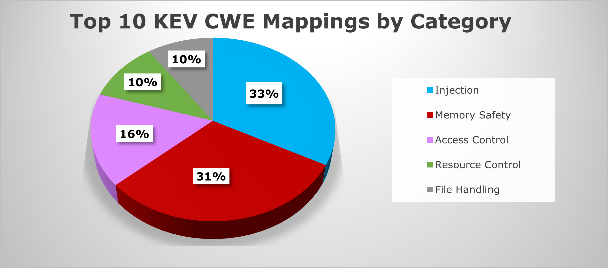

# C Runtime vs. Rust Compile Time



*Source: [MITRE, 2025 CWE Top 10 KEV List Insights](https://cwe.mitre.org/top25/archive/2025/2025_kev_insights.html).*

## Memory safety, made concrete

This repository is a compact technical study of how the same memory-safety failures
behave in C and Rust. It uses minimal, runnable examples instead of abstract claims:
the C programs demonstrate undefined behavior, while the Rust programs show which
mistakes are rejected by `rustc` and which are guarded at runtime.

The project follows two concrete failures—use-after-free and out-of-bounds write—and
compares manual runtime responsibility in C with Rust's ownership and bounds checks.
The [technical documentation](docs/memory-safety.md) explains the motivation, graphics,
and sources in more detail.

> **Thesis:** Rust moves a large class of memory-safety decisions from production
> runtime behavior into compile-time verification, without requiring a garbage
> collector. It is not a universal guarantee: `unsafe` code, FFI, and runtime bounds
> checks remain important boundaries.

## What it demonstrates

| Failure mode | C | Rust |
| --- | --- | --- |
| Use-after-free | Compiles and has undefined behavior | Rejected because a borrow outlives its owner |
| Out-of-bounds write with a constant index | Compiles and may overwrite adjacent memory | Rejected by the compiler's unconditional-panic lint |
| Out-of-bounds write with a runtime index | Compiles and has undefined behavior | Bounds checked at runtime and aborts with a panic |
| Heap lifetime management | Manual `malloc`/`free` discipline | Ownership and `Drop` determine the lifetime |

The examples are deliberately small so that the safety boundary is visible in a code
review or an interview. They are not exploit demonstrations or production patterns.

## Documentation

- [Memory-safety concepts](docs/memory-safety.md) — ownership, borrowing, lifetimes,
  bounds checks, undefined behavior, and the limits of the model.
- [C and Rust comparison](docs/comparison.md) — a side-by-side reading of both
  examples and the compile-time/runtime distinction.
- [Examples](examples/README.md) — source layout, commands, expected outcomes, and
  the intentionally failing Rust snippets.

## Repository map

```text
.
├── README.md
├── docs/                         # explanatory technical documentation
├── examples/
│   ├── c/                        # undefined-behavior examples
│   └── rust/                     # compile-time and runtime checks
├── assets/                       # diagrams used by the documentation
└── legacy/                       # archived Typst paper and original project layout
```

The original German seminar paper, Typst sources, bibliography, PDF, presentation
assets, and previous example layout are preserved in [`legacy/`](legacy/).

## Start here

- Read the [memory-safety concepts and source notes](docs/memory-safety.md).
- Compare the [same failures in C and Rust](docs/comparison.md).
- Run or inspect the [example catalog](examples/README.md).

## Scope and limitations

This project focuses on memory safety, not general application security. Rust's safe
subset prevents many classes of invalid memory access, but it does not prevent logic
bugs, data races in all designs, denial of service, insecure APIs, or vulnerabilities
introduced through `unsafe` and foreign-function interfaces. Runtime indexing still
has a cost, and migrating an existing C/C++ codebase requires engineering effort.

## License and provenance

The active documentation is a cleaned technical presentation of the material in the
archived seminar paper. External statistics and illustrations retain their original
citations and provenance in [`legacy/ausarbeitung/Seminararbeit.bib`](legacy/ausarbeitung/Seminararbeit.bib).
