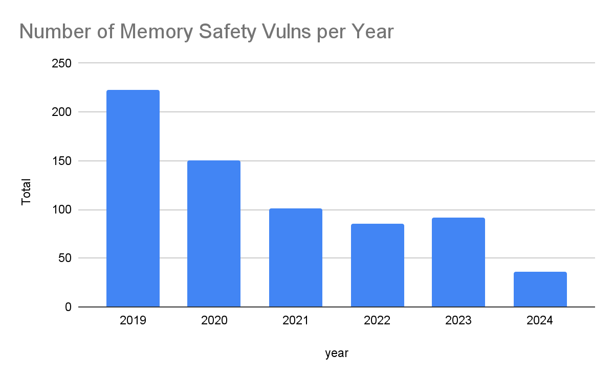

# Memory-safety concepts

## What memory safety means

A program is memory-safe when every possible execution respects the validity and
lifetime of the memory it accesses. Typical violations include:

- **Out-of-bounds read/write:** an access outside an array or buffer;
- **use-after-free:** an access after the allocation's lifetime ended;
- **double free:** releasing the same allocation twice;
- **use of uninitialized memory:** reading bytes before they hold a valid value.

In C, these violations are generally undefined behavior. The language does not promise
what the program will do after the invalid operation. It may appear to work in one
build and fail in another.

Memory safety is one category within application security, alongside areas such as
injection and access control. The original study used the following CWE/KEV overview
to provide that context:


The chart's message is directional rather than absolute: memory safety is not the
only security concern, but it is prominent enough among exploited weaknesses to
justify language-level safeguards. The examples below explain what those safeguards
change in practice.

**Source:** [MITRE, “2025 CWE Top 10 KEV List Insights”](https://cwe.mitre.org/top25/archive/2025/2025_kev_insights.html).
The graphic groups the ten most frequently exploited weaknesses by category; it is
not a chart of all vulnerabilities.

The C form has no built-in bounds check:

```c
int array[2] = {2, 2};
array[2] = 99; // undefined behavior
```

## Ownership

Rust assigns each value an owner. There is one owner at a time, and the value is
dropped when that owner leaves its scope. Moving a `Box<T>`, `String`, or `Vec<T>`
transfers ownership; it does not create a second responsible pointer.

```rust
let first = Box::new(42);
let second = first; // ownership moves
// first can no longer be used here
```

This gives the compiler enough information to insert deterministic cleanup without a
garbage collector. The ownership example in
[`examples/rust/ownership-and-borrowing/ownership.rs`](../examples/rust/ownership-and-borrowing/ownership.rs)
also contrasts heap moves with copied stack integers.

## Borrowing and lifetimes

References temporarily borrow a value without taking ownership. Rust enforces the
aliasing rule that either one mutable reference or any number of immutable references
may exist at a time. A reference must also remain within the lifetime of the value it
points to.

```rust
fn increment(value: &mut i32) {
    *value += 1;
}
```

The borrow checker rejects a reference that would outlive its owner. That is why the
use-after-free example fails before an executable is produced:

```text
error[E0505]: cannot move out of `owner` because it is borrowed
```

See the minimal snippets in
[`examples/rust/ownership-and-borrowing/borrowing.rs`](../examples/rust/ownership-and-borrowing/borrowing.rs)
and [`lifetimes.rs`](../examples/rust/ownership-and-borrowing/lifetimes.rs).

## Bounds checks: compile time and runtime

Rust arrays and slices carry their length. A statically known invalid index can be
rejected by the compiler. If the index is only known at runtime, Rust inserts a
bounds check and panics when the index is invalid. That is a controlled failure, not
an unchecked write into adjacent memory.

This distinction matters: Rust is not claiming that every invalid input is impossible
at compile time. It guarantees that safe indexing does not silently access memory
outside the collection.

For a dynamic index, the equivalent safe Rust operation is:

```rust
fn write_at_index(array: &mut [i32], index: usize) {
    array[index] = 99;
}
```

An invalid runtime index produces a panic rather than an unchecked write:

```text
index out of bounds: the len is 2 but the index is 2
```

## From mechanism to practice

The original study also tracks Android's reported memory-safety vulnerabilities over
time:



The downward trend is consistent with a strategy that prefers memory-safe languages
for new components while retaining existing native code. It should be read as
industry context, not as proof that Rust alone caused the reduction: reporting,
project scope, mitigations, and engineering practice also affect the numbers.

**Source:** [Google Security Blog, “Eliminating Memory Safety Vulnerabilities at the Source”](https://security.googleblog.com/2024/09/eliminating-memory-safety-vulnerabilities-Android.html),
by Jeff Vander Stoep and Alex Rebert, published in 2024. The chart reports Android
memory-safety vulnerability counts and percentages discussed in that article.

## Reproducing the examples

The [example catalog](../examples/README.md) contains the commands for compiling the
C and Rust files, including the intentionally failing Rust invocations. This keeps
the conceptual discussion here focused while making the experiments easy to repeat.

## Safety boundary

The guarantees described here apply to safe Rust. An `unsafe` block can opt out of
some compiler checks, and FFI can import assumptions from C or another language.
Those boundaries require the same discipline as manual memory management and should be
small, documented, and tested.
